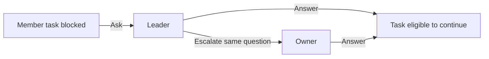

# Next engine slice: durable questions and answers

25 October 2026 — **proposal ready for owner review; implementation not authorized**

Phase 2A passed its [bounded exit review](../phase2a-exit/README.md). The next
proposed slice fills Architecture 4.5's question flow: a member asks its Leader,
the Leader can pass the same question to the owner, and an explicit authorized
answer lets the blocked task continue. Its reservation stays held throughout.

This diagram describes proposed in-process roles, not a new transport or UI.
Leader-authored questions route directly to the owner. No automatic answer or
action follows an answer. Scope is deliberately bounded: one question per
assignment, twenty questions per session, fresh schema 4 and the existing fixed
synthetic core/witness composition. Escalation does not need a Leader task.

The [amendment](AMENDMENT.md) is the concrete approval target; its linked
[contract](CONTRACT.md) specifies closed commands, role-filtered views, blocked
state, raw bypass gates, question event budgets, stop/recovery and exit tests.
Question budgets are additional to existing terminal/stop reserves. The accepted
Phase 2A source and its historical evidence remain unchanged.

Architecture 11.2 ends the previous exception at the Phase 2A exit review.
This proposal grants no development or execution permission. After explicit
approval, record the owner's response against this frozen commit/digests, then
implement and review actual source before its first qualified test run.

Review outcomes and document checks are recorded in [review.json](review.json)
and [verification.json](verification.json). Run
`rtk proxy python -X utf8 -B output/phase2b-entry/verify.py` to check proposal hashes
and their accepted baseline. This checks documents; it does not execute an engine.
No runnable implementation or hypothetical test-pass claim is included.

Provider/native integration, UI, terminals, authenticated MCP, real project/Git
operations, exports and release remain **HOLD**. Multiple questions per task,
questions during in-flight effects, arbitrary chat, automatic supervision,
takeover/succession and mission completion require later scope.
