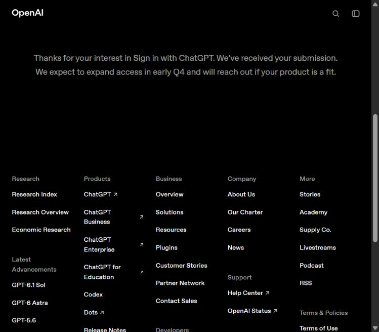

# OpenAI integration inquiry submitted

Date: 16 October 2026.

The project owner explicitly authorized contacting OpenAI using the prepared
[scope inquiry](../s4-codex-candidate/PROVIDER-CLARIFICATION.md) and supplied
contact details for the submission. Those details are excluded from this record.

## Submission and observed result

- Channel: [official Sign in with ChatGPT interest form](https://openai.com/form/sign-in-with-chatgpt-interest/), linked by the [client-ID documentation](https://developers.openai.com/siwc/request-client-id).
- Product: TIYE Agent; website: the project's GitHub repository.
- Requested capability: sign-in plus ChatGPT plan use for AI requests.
- Message: product description, all four questions and the three references from
  the prepared inquiry. Draft-only preparation notes were omitted.
- The browser displayed an explicit acknowledgement that OpenAI received the
  submission. The form disappeared. No receipt number was displayed.
- One submit action was performed; no duplicate submission was attempted.

This is a commercial-interest submission carrying the scope questions, not a
support case with a promised response. The acknowledgement says OpenAI may
contact products that fit. Its expansion timing is not treated as a commitment
or eligibility decision for TIYE.

## Effect on readiness

The inquiry is now **submitted; provider response pending**. Earlier records
describing it as unsent are historical snapshots. Keep those captures frozen.
This record supersedes their outreach status only.

No substantive answer, client ID, program acceptance, inference authorization
or model entitlement was received. The selected product route remains
unqualified. S4/S6 remain partial and Phase 1 remains **HOLD**. No native login,
provider-backed Linux experiment or billing change was performed.

The owner should share any substantive reply so its scope can be assessed before
authenticated qualification. No mailbox monitoring or automatic follow-up was
configured. Protocol preparation can continue under the existing
[conditional plan](../s4-codex-transport-assessment/NEXT-RUN.md).
