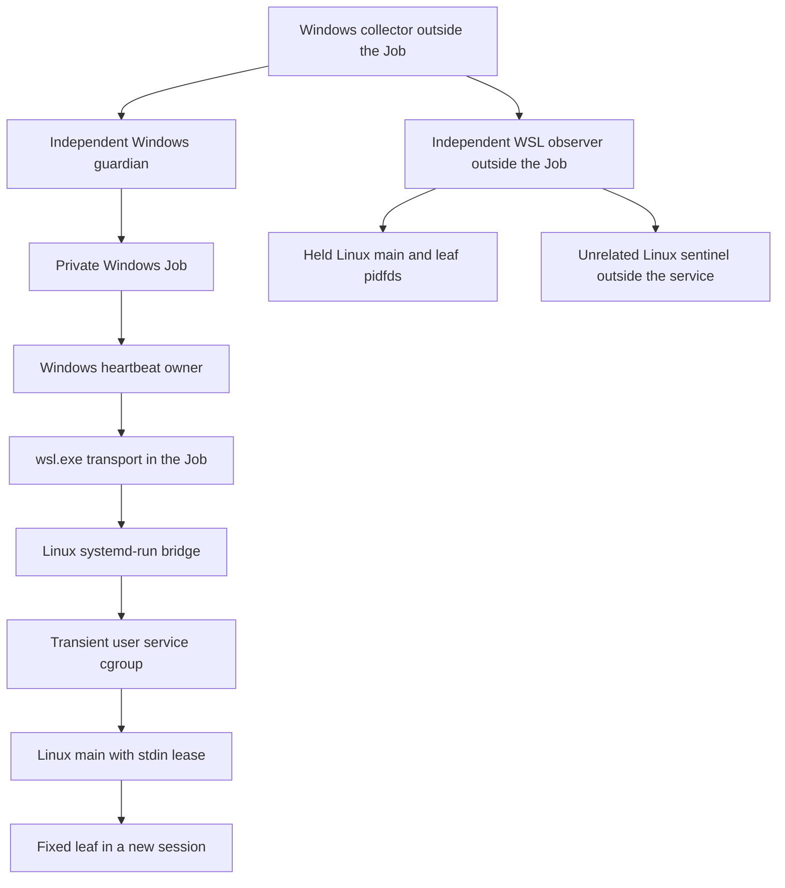

# Charged WSL lease and independent cleanup witness

19 October 2026

The Windows Job watchdog now participates in a separate synthetic cross-OS
composition. Windows owner exit, guardian loss and heartbeat stall all require
independent Linux cleanup evidence. Six tests cover those three live cases,
heartbeat/budget boundaries and a cgroup-removal regression. Two additional
offline tests reject altered sources/budgets/clocks and forged public verdicts.

**Native provider execution remains disabled.** The tested runtime launched no
provider CLI and made no account, credential-backend or model request. Development
delegation is separate from that runtime. L1/L2 remain PARTIAL, P1/P2 OPEN,
A1 BLOCKED and Phase 1 HOLD. Historical code and evidence are unchanged.

## Ownership across the Windows/Linux boundary



The guardian reuses the frozen Windows Job implementation and decision loop.
The new entry point deliberately binds their imported composition to this source
set and checks module identity. File contents are not changed. Fresh nonces and
source fingerprints reject stale control records/configuration; they are not
secret authentication credentials or independent code attestations.

The heartbeat owner launches only the fixed Ubuntu/Python bridge. The bridge
executes `systemd-run --user --pipe --wait --collect` for a nonce-named transient
service. Applied properties are queried before loss injection: control-group
killing, main-process exit semantics, no restart/delegation, SIGKILL escalation,
0077 umask, 20-second runtime ceiling and two-second stop timeout. The observer
binds the unit's invocation ID, main PID and exact cgroup. It holds live pidfds
for the main and leaf, verifies their identities and confirms the observer and
sentinel are outside the unit and its child cgroups before announcing readiness.

The leaf starts a new session but remains in the service cgroup. Session IDs
provide identity evidence, not containment. Kernel service cleanup supplies the
group lifecycle behavior. This is a fixed two-process Linux fixture, not proof
that arbitrary same-account code cannot fork, migrate or escape. Both the leaf
and sentinel receive DEVNULL stdin, not the heartbeat channel.

## Lease renewal no longer rewrites a file

Windows sends bounded UTF-8 JSON lines carrying a nonce and exact increasing
sequence number. The Linux main accepts only the next sequence, rejects duplicate
keys/nonfinite numbers and caps its pending input at 4096 bytes. It stamps receipt
using its own monotonic clock. Complete valid packets renew a one-second lease;
partial bytes do not. EOF or lease silence produces a terminal record followed
by exit 71. Terminal persistence is inside a `finally` exit path, so a failed
terminal write does not keep the service main alive after a detected valid-stream
lease loss. Other startup/parser failures do not earn the same terminal evidence.

No mutable timestamp/heartbeat file is written. The main's exit causes systemd
to stop the remaining service cgroup. The independent observer requires signaled
main/leaf pidfds, absent original `/proc` entries, an empty or removed owned cgroup
and a live unrelated sentinel. It checks the terminal nonce/PID, at least one
accepted heartbeat and the EOF/expiry reason. When manager terminal properties
remain available, the invocation and main exit status 71 must still match.
These observations must precede any harness rescue stop. Only then is a selected
result eligible for publication; an unknown/unsettled outcome stays unqualified.

The observer finalizer stops its sentinel and closes held descriptors even when
its unit-query/rescue path raises. A rescue stop requires the already bound unit
invocation. Rescue work never earns a passing cleanup verdict. Runtime files are
retained, with no automatic deletion or relaunch admission.

## Two accounting domains

During each measured case, Windows persistence uses the existing disjoint collector/worker
subleases. The collector has a second protected capture root for Linux observer
diagnostics, sharing the **same** collector ledger. Both stdout/stderr drains are
serialized at persistence. Every persisted copy, including final evidence, is
charged before I/O. The worker's final counter is lost after forced termination;
its prefix remains uncertain and final file-size checks do not replay that counter.

| Windows accounting owner | Collector | Worker | Combined |
| --- | ---: | ---: | ---: |
| Controller | 128 KiB | 384 KiB | 512 KiB |
| Stream metadata | 32 KiB | 96 KiB | 128 KiB |
| Observer/diagnostics | 64 KiB | 192 KiB | 256 KiB |
| Reserved, unwritable | — | — | 128 KiB |

The Windows metadata budget remains 1 MiB including reserve. Raw protocol files
are empty in this cohort; there is no native protocol/capture-completion credit.
The collector's combined measured metadata must equal its gross charges on these
successful fixture operations. Terminated worker file sizes must fit its sublease.

Linux private runtime content has a **separate 128 KiB budget**:

| Role | Allocation | Owned files |
| --- | ---: | --- |
| Bootstrap | 64 KiB | Bound Python source, configuration and uncertain-retention record |
| Worker | 16 KiB | Startup identities and terminal lease record |
| Observer | 32 KiB | Final runtime audit |
| Reserved, unwritable | 16 KiB | No writer |

These roles have disjoint ledgers and fixed filenames. Writes charge the full
attempt before exclusive no-follow creation and one `os.write`; failures do not
refund. Owned files are 0600 under an exclusive 0700 UID-1000 root, accessed through
held directory descriptors. Runtime reads/audits reject links, unexpected files,
owners, types and oversized contents. Source/configuration hashes are rechecked
at bridge, worker and observer entry. Final totals include the audit itself.
Application counters do not constitute filesystem quotas or protection against
the user's own account authority. System-manager/journal storage, filesystem
metadata, arbitrary external writes and process RSS are outside these content
budgets. Linux counters are not silently deducted from Windows headroom.

## Measured loss cases and clocks

| Case | Windows evidence | Independent Linux evidence |
| --- | --- | --- |
| Owner exit | Root exits 17; guardian stops remaining Job, held root/transport handles signal and Job-empty is reported | Lease ends by EOF or expiry, held Linux identities disappear and cgroup empties while sentinel survives |
| Guardian loss | Guardian is killed; held root/transport handles signal; Job-empty remains `null` because no guardian report exists | The same Linux checks are still required; Windows death alone is insufficient |
| Heartbeat stall | Owner sleeps synchronously for 95 seconds; frozen watchdog stops it at its five-second deadline | Lease must specifically expire, and the collector must receive the verified Linux result before even the earliest Windows stop deadline |

The final composition retains the already measured **five-second Windows
watchdog**, anchored immediately before suspended Job creation, rather than the
12-second value considered in the review brief. Linux lease age uses Linux
monotonic receipt time. The before-watchdog check compares only timestamps taken
by the Windows collector; it never compares absolute Windows/Linux clock values.
Linux cleanup observation is limited to eight seconds. The service's 20-second
runtime limit is fallback policy, not credited as lease cleanup. A missing lease
terminal record, a wrong available exit status, a late stall result or failed
witness check prevents a passing case.

This is not a unified native 60/75/90-second deadline implementation. Synchronous
filesystem/Win32 calls, machine suspension, unknown spawn, observer/collector
crashes, blocked kernel tasks and adversarial descendant/migration behavior remain
unqualified. Budget exhaustion during real disk failure and hostile filesystem
mutation are also unqualified. The native effective configuration/helper policy
and applicable authenticated provider route remain separate work.

## Verification and regression

```powershell
rtk proxy python -B -X utf8 feasibility/s6-wsl/charged-wsl/run.py
rtk proxy python -B -X utf8 feasibility/s6-wsl/charged-wsl/run.py --develop
rtk proxy python -B -O -X utf8 -m unittest discover -s feasibility/s6-wsl/charged-wsl -p test_charged.py -v
rtk proxy python -B -X utf8 -m unittest discover -s feasibility/s6-wsl/charged-wsl -p test_publication.py -v
```

The default command checks saved sources/artifacts/references offline. Development
mode runs six tests in the installed Windows/Ubuntu environment and retains full
diagnostics in a separate protected harness budget. Linux runtime directories and
Windows private prefixes remain retained. [Observations](observations.json) publish
only selected verdicts. Hashes are local consistency checks, not independent
attestation, durable-storage qualification or private-trace replay.

Normal/optimized runs refer to the Windows harness and its imported pure contract
checks. The fixed Linux execution uses `-I -S -B` in both runs; Linux runtime
execution under `-O` is not separately qualified by this cohort.

A real rerun caught cgroup removal between an existence probe and reading
`cgroup.events`. The observer now treats a missing events file as empty only when
the owned cgroup directory is also gone. The regression test uses temporary
filesystem states; the three integrated cases use actual systemd cgroups and
pidfds. Failed-cohort diagnostics remain protected and are not substituted for
the selected passing cohort.

Luna and GLM completed supplied-context design reviews, without tools or edits;
neither inspected final sources or ran this cohort. [Review](review.json) records
the adopted findings and scoped exclusions. Gemini remained excluded under the
recorded consumer-route decision; DeepSeek fallback was unnecessary. Parent Clean
Code Guard, Test Guard and Docs Guard passes are recorded there as well.

**Next:** connect this ownership path to the shared native phase schedule and
define unknown-outcome recovery, then review the effective configuration/helper
inventory for separate U0 admission. Authenticated A0/T0 still needs its own
provider-route decision and protocol/effect contract.
