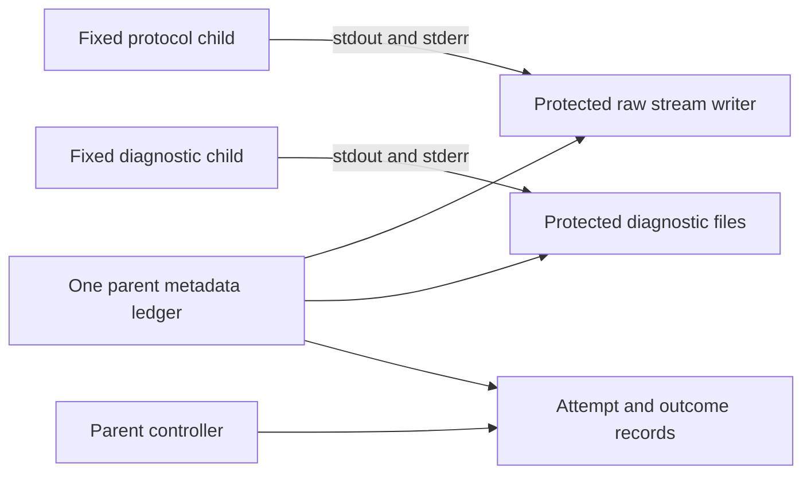

# Enforced resource policy in a synthetic Windows composition

19 October 2026

The shared metadata ledger and phase clock now drive a separate Windows
direct-child composition. Three live synthetic cases exercise success,
diagnostic allocation exhaustion and initialize timeout. Eleven tests cover
those cases plus protected persistence and deadline refusal. Two additional
offline tests reject source drift and invalid publication claims.

**Native execution remains disabled.** This does not qualify the existing WSL
launcher, a provider route, the Codex binary or descendant cleanup. L1/L2 remain
PARTIAL, P1/P2 OPEN, A1 BLOCKED and Phase 1 HOLD. Historical sources and evidence
are preserved.

## Persistence has one owner

The previous WSL launcher has direct writers in several processes. Its writes
cannot share a thread-local ledger merely by importing the policy module. This
new composition instead gives the parent exclusive persistence responsibility
for fixed synthetic children, which emit through pipes and do not write files.



| Owner | Live allocation | Persistence path |
| --- | --- | --- |
| Controller | 512 KiB | `MetadataFiles.write`: attempt and outcome files |
| Stream | 128 KiB | `BudgetCapture._metadata`: inherited retention and completion writes |
| Observer/diagnostics | 256 KiB | `MetadataFiles.write`: diagnostic stdout and stderr |
| Reserved | 128 KiB, unwritable | No persistence path |

Together these enforce the proposed 1 MiB metadata allocation **within this
composition**. Raw protocol stdout/stderr retain the inherited separate 4 MiB
and 1 MiB limits. The parent charges each full attempted metadata write before
I/O. It does not retry or refund failed, uncertain or short writes. The inherited
stream component cap remains an additional check; it does not charge the shared
ledger again. Empty exclusive file creation consumes no content-byte charge.

Files are created with the existing protected Windows allocator and held through
verified descriptors. Root/child inventories, owner/access rules, single-link
metadata, file sizes and incremental content hashes are checked before a result
returns. A final audit seals the metadata sink against further writes. The final
size audit and gross attempted-write ledger are distinct checks.

Diagnostic allocation or persistence failure revokes new work and faults raw
capture. Pumps continue consuming finite child output, discarding later bytes
instead of leaving pipes blocked. The failed diagnostic chunk is not included in
the subsequent-discard counter: an OS error can leave its persisted amount
uncertain. Bounded controller outcome records remain permitted after a fault.

This is a trusted parent/synthetic-child arrangement. Private descriptors and
source identity do not sandbox another process running under the same account.
There is no filesystem quota, adversarial child isolation or arbitrary-path
writer API.

## Waits use the shared phase clock

The Windows monotonic origin is recorded before protected allocation or spawn.
Host startup, child startup and initialize use the existing 30/15/15-second
phase caps, clipped to T+60. New spawn/input work is refused after revocation or
an expired phase. `PhaseClock.wait` uses the current remaining window and
`asyncio.wait`; it does not wait for a cancellation grace period.

Cleanup revokes work before EOF, TERM and KILL. Each phase uses its remaining
five-second window within the shared fifteen-second cleanup budget, clipped to
T+75. Process waits and pipe draining consume that same phase window. Pending
spawn tasks retain ownership accounting; they are not treated as proof that no
child was created. Signals are checked against the current phase cutoff.

Observation is clipped to T+90 and sends no fresh signals. If pumps remain when
observation begins, capture is faulted before further draining, suppressing new
raw/diagnostic persistence. Unsettled children or pipes prevent a successful
result. No recovery/relaunch admission is produced.

The timeout fixture actually waits fifteen seconds for initialize and reaches
EOF then TERM. Windows termination already kills this direct child; KILL
escalation is implemented but not exercised by this cohort. The successful
fixture checks storage/lifecycle plumbing only: its simple response event is
not a JSON-RPC handshake validator or evidence of native protocol compatibility.

These are cooperative async wait bounds. Synchronous allocation, writes, fsync,
readback and close can block the event loop, and final evidence I/O can extend
past the observation window. There is no independent Windows Job watchdog in
this composition. Unknown/late spawn behavior, cancellation-resistant shutdown,
controller death, suspended clocks, hostile descendants and Linux service/lease
deadlines remain unqualified. Harness rescue, if needed, earns no cleanup credit.

## Verification and evidence

```powershell
rtk proxy python -B -X utf8 feasibility/s6-wsl/resource-launcher/run.py
rtk proxy python -B -X utf8 feasibility/s6-wsl/resource-launcher/run.py --develop
rtk proxy python -B -O -X utf8 -m unittest discover -s feasibility/s6-wsl/resource-launcher -p test_resources.py -v
rtk proxy python -B -X utf8 -m unittest discover -s feasibility/s6-wsl/resource-launcher -p test_publication.py -v
```

The default command validates saved source/artifact/reference hashes and selected
scope without launching children. `--develop` runs eleven Windows tests and
writes a fresh selected result under `.git`; protected raw diagnostics and full
runtime state remain outside public output. The development test report has its
own separate protected ledger, outside the three measured case budgets. Public
[observations](observations.json) contain only allowlisted case verdicts. Hashes
provide local consistency, not independent attestation or a private-trace replay.

Tests check initial and completion stream charges, the exact diagnostic cap and
one extra byte, no refund after injected short/ENOSPC writes, second-writer
refusal, inventory/content drift, sink sealing, expired-window refusal, work
revocation, actual child reaping and actual pipe draining. Injected ENOSPC is not
a real full-disk qualification. Existing immutable offline cohorts are checked
separately; they do not inherit the new composition's allocation claims.

Luna and GLM completed supplied-context design reviews, with no tools or edits.
Neither inspected the final source or ran these tests. Gemini remained excluded
under the recorded consumer-route decision; DeepSeek fallback was unnecessary.
[Review](review.json) records their reports and the parent review decisions.

**Next:** bring an independent Job/watchdog and WSL observer/lease writers into a
new composition with the same charged persistence and clock contract. Resolve
blocked-I/O and uncertain-spawn behavior before claiming a host deadline. Native
U0 also needs the effective configuration/helper inventory and separate admission
review; authenticated A0/T0 additionally needs the applicable provider route.
