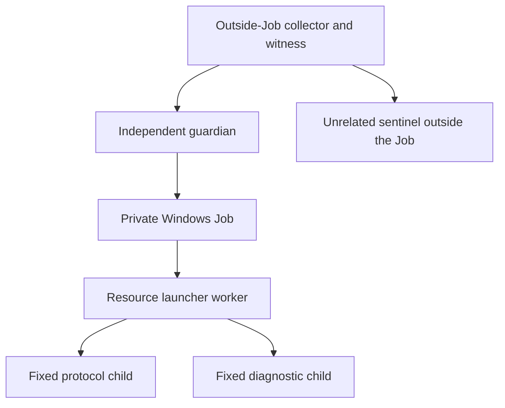

# Independent Windows Job watchdog with partitioned metadata accounting

19 October 2026

An independent guardian now supervises the previous synthetic resource launcher
and its Windows descendants. Four real cases exercise normal completion, a
synchronously blocked event loop, launcher exit with a live protocol child, and
guardian loss. Eight Windows tests cover these cases and the control/accounting
boundaries. Two offline tests reject altered leases, source drift and forged
publication claims.

**This is synthetic Windows evidence. Native execution remains disabled.** WSL
observer/lease integration is still pending. L1/L2 remain PARTIAL, P1/P2 OPEN,
A1 BLOCKED and Phase 1 HOLD. Historical sources and manifests are unchanged.

## Independent process ownership



The guardian reuses the immutable `ChildJob` implementation. The worker is
assigned to a private kill-on-close Job at suspended creation and resumed after
assignment. The helper creates a non-inheritable Job handle and starts the
worker without inherited handles. Fixed descendants use normal process creation
and inherit Job membership. The collector holds process handles, not copies of
the Job handle. Source inspection confirms these paths; no global OS handle
enumeration or adversarial handle-duplication audit was performed.

While the Job is live, the guardian only queries Job accounting/process state,
checks its monotonic clock and requests termination. It does not read or write
files, emit progress records or wait on the launcher's event loop. Its bounded
JSON report is emitted after Job cleanup and close. The collector drains both
guardian pipes concurrently into protected diagnostic files, charging each
persisted copy. A stalled collector can prevent reporting; it cannot stall the
guardian's earlier process-stop decision through this reporting path.

The synthetic deadline is **five seconds from immediately before `ChildJob`
creation**, including suspended creation and startup. It is not anchored to the
ready record. A root exit with remaining Job members requests immediate Job
termination; it does not wait for the deadline. Explicit cleanup observation is
at most two seconds. The reused helper has additional exceptional close/recovery
logic; this is not a two-second hard bound on every Win32 call or final exit.
Passing reported cases require Job-empty and a signaled root within the explicit
observation, and record decision/request-return/observation/post-close timings.

This five-second cohort does not qualify the native 60/75/90-second schedule,
machine suspension, unscheduled threads, blocked Win32 calls or a universal hard
deadline. The guardian's own startup/source validation and collector setup precede
that timer. A stall in the guardian itself is not handled by another supervisor.

## Disjoint accounting across processes

Two fixed subleases replace any assumption that separate processes share a
thread-local ledger. Each role precharges the inaccessible complement of the
existing per-owner ledger, so it cannot borrow the other role's allocation.
The guardian persists no files. Its final pipe bytes are charged by the collector
when persisted. These are application accounting caps, not filesystem quotas.

| Accounting owner | Collector | Worker | Combined |
| --- | ---: | ---: | ---: |
| Controller | 128 KiB | 384 KiB | 512 KiB |
| Stream metadata | 32 KiB | 96 KiB | 128 KiB |
| Observer/diagnostics | 64 KiB | 192 KiB | 256 KiB |
| Reserved, unwritable | — | — | 128 KiB |

The combined metadata allocation remains 1 MiB including reserve. Raw protocol
stdout/stderr keep their separate 4 MiB/1 MiB limits in the worker; collector raw
protocol files remain empty. Retention and completion metadata are charged before
allocation/persistence through the inherited protected writer. Attempt/outcome
records and diagnostic chunks use held protected descriptors. Collector diagnostic
writers share a lock so simultaneous pipe drains cannot lose owner totals.

Worker intent, ready and final result control files charge the worker's controller
sublease. The collector's one-shot owner-exit release file charges its controller
sublease. Exclusive control writes charge their entire attempt before I/O, perform
one `os.write`, flush and read back; errors and duplicate-publication attempts
never refund. No leases are transferred or dynamically enlarged. The initializer
is explicitly repeated in a small subclass because the immutable predecessor
does not accept a budget dependency; inherited protocol, pipe and cleanup methods
remain source-bound. Revisit that seam when replacing the feasibility API.

Final audits check protected inventories, file types/link counts, raw file caps,
role metadata totals and aggregate sizes. A normal worker's saved charges,
including its final control result, must match its measured metadata sizes. The
collector's own charges must match its sizes. For terminated workers, the lost
in-memory gross-charge counter cannot be independently replayed: fixed source
enforcement and final-size checks are recorded, and worker evidence stays
uncertain. Retained worker files are not revalidated against a trusted content
baseline after termination. There is no automatic deletion or relaunch admission.

## Observed outcomes

| Case | Required observation |
| --- | --- |
| Valid | Worker confirms storage completion and direct-child drain/reap; guardian reports Job-empty and root exit zero |
| Blocked event loop | Worker sleeps synchronously for 95 seconds while a real protocol descendant also sleeps; guardian stops the Job at five seconds, held root/protocol handles signal, unrelated sentinel stays alive |
| Owner exit | Witness first holds root/protocol identities, then publishes release; worker exits 17 and guardian stops the remaining Job before its deadline |
| Guardian loss | Witness kills the guardian; held root/protocol handles signal and unrelated sentinel stays alive; no guardian report or Job-empty verdict is invented |

Held identities include creation time and a fresh run nonce. The destructive
cases check both held processes, not only the launcher exit code. The sentinel
is explicitly stopped by the harness after its survival check. Harness rescue,
if needed, cannot earn a passing measured outcome. These are fixed, cooperative
fixture programs, not hostile-child or arbitrary descendant coverage. No Linux
service, cgroup, provider CLI, credentials or model request is involved.

A rerun caught a Windows publication race: a reader opened a control path while
the exclusive writer still held it, producing Win32 sharing error 32. The worker
then entered ordinary fault cleanup and reached the watchdog deadline instead of
the intended owner exit. The fix retries only missing records and that exact
sharing error within the existing wait window. Closed malformed records and
binding mismatches fail immediately. A real held-publisher regression test now
checks refusal while open and successful reading after close. Failed raw test
diagnostics remain protected and excluded from this selected passing cohort.

## Verification and remaining work

```powershell
rtk proxy python -B -X utf8 feasibility/s6-wsl/resource-watchdog/run.py
rtk proxy python -B -X utf8 feasibility/s6-wsl/resource-watchdog/run.py --develop
rtk proxy python -B -O -X utf8 -m unittest discover -s feasibility/s6-wsl/resource-watchdog -p test_watchdog.py -v
rtk proxy python -B -X utf8 -m unittest discover -s feasibility/s6-wsl/resource-watchdog -p test_publication.py -v
```

Default operation is an offline saved-source/artifact/reference check.
`--develop` runs eight Windows tests and retains full logs/state in a separate
protected harness budget. Selected results under `.git` can be reviewed before
publishing. [Observations](observations.json) allowlist verdicts and use `null`
when no Job-empty report or no held-process/sentinel observation exists. Raw
paths, identities and control records remain private. Hashes establish local
consistency, not independent attestation or a replay of private process traces.

Luna and GLM completed supplied-context design reviews with no tools or edits;
neither inspected final source or executed the cohort. Their adopted findings
and parent guard passes are in [review](review.json). Gemini remained excluded
under the recorded consumer-route decision. DeepSeek fallback was unnecessary.

**Next:** integrate WSL observer/lease persistence through charged ownership and
reconcile Linux cleanup with the host clock. Windows Job termination alone does
not establish Linux process death. Collector blocked I/O, uncertain spawn/recovery
and native effective configuration/helper admission also remain open. The native
U0 admission and authenticated A0/T0/provider route are separate decisions.
